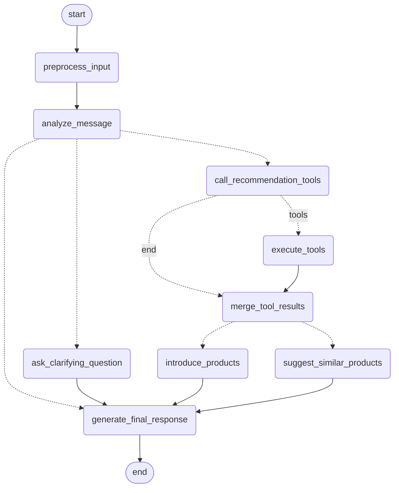

# دستیار فروش هوشمند (LangGraph + Telegram)

دستیار فروش برای یک فروشگاه اینترنتی با ۵۰۰ محصول فارسی (`data/products_500.csv`)، ساخته‌شده با **LangGraph**. مثل یک فروشنده واقعی نیاز مشتری را می‌فهمد، در صورت ناقص بودن اطلاعات سوال می‌پرسد، با ترکیب **RAG** (جستجوی معنایی روی Chroma) و **Pandas** (فیلتر ساختاریافته) محصول پیشنهاد می‌دهد، مکالمه و محصولات معرفی‌شده را در Memory نگه می‌دارد، مقایسه و پیگیری خودکار (۱ ساعت / ۲ روز) انجام می‌دهد، و ورودی تصویر/لینک را هم پشتیبانی می‌کند.

طراحی اولیهٔ گراف (فاز ۱) در [Graph_Final.xlsx](Graph_Final.xlsx) است؛ این ریپو پیاده‌سازی واقعی همان طراحی (فاز ۲) است.

## راه‌اندازی

```bash
python -m venv .venv
.venv\Scripts\activate          # ویندوز
# source .venv/bin/activate     # لینوکس/مک

pip install -r requirements.txt
cp .env.example .env            # و مقادیر واقعی رو داخلش بذار
```

مقادیر لازم در `.env`:
- `LLM_BASE_URL` / `LLM_API_KEY` / `LLM_MODEL` — یک پروکسی سازگار با OpenAI API (مثل AvalAI یا MetisAI؛ این پروژه با `https://api.metisai.ir/openai/v1` و مدل `gpt-4o-mini` تست شده است، هم برای چت و هم برای Vision).
- `TELEGRAM_BOT_TOKEN` — از [@BotFather](https://t.me/BotFather).
- `EMBEDDING_PROVIDER` — پیش‌فرض `proxy` (embeddings همون پروکسی)؛ اگه پروکسی embeddings نداشت، خودکار به مدل محلی `intfloat/multilingual-e5-small` سوییچ می‌کنه (یا با `EMBEDDING_PROVIDER=local` مستقیم فورس کن).

### ترتیب اجرا

```bash
python scripts/test_tool_calling.py   # ۱) اول مطمئن شو پروکسی از bind_tools پشتیبانی می‌کنه
python scripts/build_index.py         # ۲) ساخت ایندکس Chroma از روی CSV
python scripts/chat_cli.py            # ۳) چت محلی بدون تلگرام، برای توسعه/دیباگ سریع
python main.py                        # ۴) اجرای واقعی ربات تلگرام
```

`chat_cli.py` با فلگ `--persist` از همون SQLite checkpoint ربات واقعی استفاده می‌کنه؛ بدونش state فقط در حافظه‌ست (برای تست سریع بهتره).

## گراف واقعی پیاده‌سازی‌شده

خروجی مستقیم `graph.get_graph().draw_mermaid()` روی گراف کامپایل‌شده (نسبت به طراحی اولیه در Graph_Final.xlsx، فقط یک گره اضافه دارد: `preprocess_input` که ورودی تصویر/لینک را قبل از تحلیل پیام به متن فارسی تبدیل می‌کند):



## نگاشت قابلیت‌های اجباری LangGraph

| قابلیت | کجای کد |
|---|---|
| **State Management** | `app/state.py` — یک `SalesState(TypedDict)` واحد که در تمام گراف جریان دارد؛ `user_profile`/`discussed_products` با reducer سفارشی merge می‌شوند (نه overwrite) |
| **Conditional Routing** | `app/graph/routing.py` — `route_after_analysis` (چک Memory/کامل بودن اطلاعات)، `route_after_match_check` (محصول پیدا شد یا نه)، به‌علاوه `tools_condition` استاندارد LangGraph |
| **Tool Calling** | `app/graph/nodes.py:call_recommendation_tools` با `bind_tools` + `ToolNode` از `langgraph.prebuilt` (`app/graph/builder.py`) — گره `execute_tools` هر دو ابزار `pandas_filter_tool` و `rag_search_tool` را با آرگومان‌هایی که خود مدل تعیین می‌کند اجرا می‌کند |
| **Memory** | Checkpointer پایدار (`AsyncSqliteSaver`, کلید = `telegram_chat_id`) در `app/bot/telegram_bot.py:post_init` — سوال دربارهٔ محصول قبلاً معرفی‌شده بدون جستجوی مجدد از `discussed_products` پاسخ داده می‌شود (`intent="known_product_question"`) |
| **Error Handling** | هر گره‌ی مبتنی بر LLM/ابزار در `app/graph/nodes.py` خطا را می‌گیرد و `RecommendationToolError` اختصاصی (`app/graph/errors.py`) پرتاب می‌کند؛ `ToolNode(..., handle_tool_errors=False)` هم خطای ابزار را واقعاً propagate می‌کند تا Retry معنا داشته باشد |
| **Retry** | `RetryPolicy(max_attempts=3, retry_on=(RecommendationToolError,))` روی تمام گره‌های LLM/ابزار در `app/graph/builder.py` |

## معماری RAG + Pandas ترکیبی

`call_recommendation_tools` مدل را با هر دو ابزار bind می‌کند؛ `merge_tool_results` نتایج `pandas_filter_tool` (فیلتر دقیق دسته/برند/قیمت) و `rag_search_tool` (جستجوی معنایی روی Chroma) را ترکیب و بر اساس امتیاز محصول رتبه‌بندی می‌کند. چون RAG همیشه چیزی برمی‌گرداند (حتی اگر بی‌ربط)، اگر مشتری دسته‌بندی مشخصی خواسته باشد، نتایج خارج از آن دسته حذف می‌شوند — این هم از آلوده شدن پیشنهادها با نتایج نامرتبط جلوگیری می‌کند و هم تشخیص «محصول موجود نیست» را درست نگه می‌دارد.

## محدودیت‌های شناخته‌شده (تصمیم‌های آگاهانه)

- **سازگاری Tool Calling با پروکسی**: بعضی پروکسی‌های سازگار با OpenAI به‌جای پر کردن `tool_calls`، متن ساده برمی‌گردانند ([langchain-ai/langchain#21887](https://github.com/langchain-ai/langchain/issues/21887)). `scripts/test_tool_calling.py` این را قبل از هر چیز چک می‌کند؛ `call_recommendation_tools` هم اگر `tool_calls` خالی برگردد، به‌صورت دستی از روی `user_profile` تماس‌های ابزار معادل می‌سازد (`_manual_tool_call_fallback`) تا مسیر بعدی گراف بدون تغییر کار کند.
- **کیفیت Embedding فارسی**: مدل پیش‌فرض sentence-transformers (`paraphrase-multilingual`) روی کوئری‌های کوتاه فارسی (مثلاً فقط «جاروبرقی») نتایج کاملاً نامرتبط می‌داد؛ به مدل retrieval-محور `intfloat/multilingual-e5-small` با پیشوند `query:`/`passage:` سوییچ شد که نتایج به‌مراتب بهتری داد (`app/data/vectorstore.py`). Embeddings پروکسی (`text-embedding-3-small`) هم تست و تأیید شده و پیش‌فرض است.
- **تشخیص خرید نهایی**: چون اتصال پرداخت واقعی خارج از دامنهٔ پروژه است، `purchase_confirmed` با یک طبقه‌بندی سبک LLM تشخیص داده می‌شود (وقتی مشتری صریحاً می‌گوید «همینو می‌خرم»/«سفارش بده» — بخش `MessageAnalysis` در `app/graph/schemas.py`).
- **استخراج لینک محصول**: `scrape_product_url_tool` عنوان/توضیحات صفحه را best-effort استخراج می‌کند (نه قیمت، چون heuristic قیمت روی سایت‌های دلخواه غیرقابل‌اتکاست) و در صورت شکست، به‌جای خطا، به مشتری مؤدبانه می‌گوید محصول را با متن توضیح دهد.

## ساختار پروژه

```
app/
  config.py              تنظیمات از .env
  state.py                 SalesState (TypedDict)
  persona.py                 شخصیت ثابت فروشنده + پرامپت‌های هر شاخه
  data/products.py             بارگذاری CSV + فیلتر Pandas
  data/vectorstore.py            ایندکس Chroma + انتخاب embedding
  tools/                          ابزارهای LangChain (@tool)
  graph/nodes.py                   گره‌های گراف (هر باکس دیاگرام یک تابع)
  graph/routing.py                   شرط‌های مسیریابی
  graph/builder.py                     ساخت و اتصال گراف نهایی
  bot/telegram_bot.py                   ربات تلگرام (python-telegram-bot)
  bot/scheduler.py                        پیگیری ۱ ساعته / ۲ روزه
scripts/                                  ابزارهای CLI (ایندکس‌سازی، چت محلی، تست پروکسی)
```

## پیگیری خودکار

هر پیام کاربر دو Job در `JobQueue` تلگرام تنظیم/ریست می‌کند: یک پیام یادآوری بعد از `NUDGE_DELAY_SECONDS` (پیش‌فرض ۱ ساعت) اگر جواب نده، و پیشنهاد مجدد + کد تخفیف بعد از `REOFFER_DELAY_SECONDS` (پیش‌فرض ۲ روز) اگر خریدی تأیید نشده باشد. چون این Jobها فقط در حافظه‌اند، `post_init` ربات هنگام استارت از جدول کوچک `bot_threads.sqlite` وضعیت را بازسازی و Jobهای معلق را دوباره زمان‌بندی می‌کند. برای تست سریع، `NUDGE_DELAY_SECONDS`/`REOFFER_DELAY_SECONDS` را در `.env` به مقادیر کوچک (مثلاً ۳۰ و ۱۲۰) تغییر بده.
